<div align="center">

# 🌾 VyaparMarg (व्यापारमार्ग)
### AI & Rule-Based Rural Business Assistant & Scheme Discovery Engine
**Hybrid Multi-Platform System: Native Android Mobile App + Browser Extension + Shared Backend**

[](https://github.com)
[](https://github.com)
[](https://fastapi.tiangolo.com)
[](https://supabase.com)
[](https://reactnative.dev)
[](https://developer.chrome.com)


</div>

---

## 🌐 Live Deployments

| Component | Live URL |
|---|---|
| Web application | https://vyapar-marg.vercel.app/ |
| FastAPI backend | https://vyaparmarg.onrender.com/ |
| API health check | https://vyaparmarg.onrender.com/api/v1/health |
| API documentation | https://vyaparmarg.onrender.com/docs |

The Render service is hosted on the free tier and may take 30–60 seconds to respond after inactivity.

---

## 📖 Canonical & Detailed Specifications
* **Complete User Flow & System Specification**: [`docs/COMPLETE_USER_FLOW_AND_SYSTEM_SPECIFICATION.md`](docs/COMPLETE_USER_FLOW_AND_SYSTEM_SPECIFICATION.md) — *Detailed 5-stage user flow, 3-Tier Seed-to-Client pipeline, API contracts, and complete system architecture.*
* **Canonical Specification**: [`docs/PROJECT_CANONICAL_SPEC.md`](docs/PROJECT_CANONICAL_SPEC.md) — *Locked problem statement, team roles, module boundaries, and security invariants.*
* **Demo Verification & Evidence**: [`docs/DEMO_VERIFICATION_EVIDENCE.md`](docs/DEMO_VERIFICATION_EVIDENCE.md) — *Automated test results, schema checks, and end-to-end demo execution trace.*

---

## 🎨 Visual Showcase & Application Previews

### 1. Hybrid Multi-Platform Ecosystem Banner

*Android smartphone with Marathi audio interface seamlessly linked to Chrome browser extension on MahaDBT portal.*

### 2. Complete End-to-End User Flow (5 Stages)
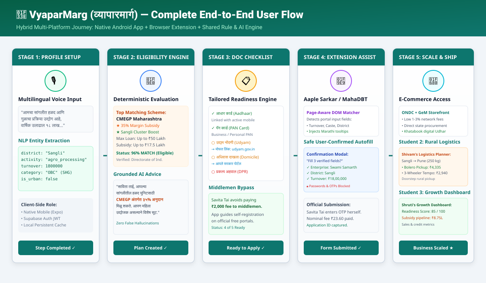
*Five-stage journey: (1) Voice Onboarding, (2) Deterministic Matching, (3) Document Checklist, (4) Extension Portal Guidance, (5) Rural Growth Hub.*

### 3. Native Android Mobile Application Showcase
| Real Android Device UI | 4-Screen Component Flow |
|:---:|:---:|
| 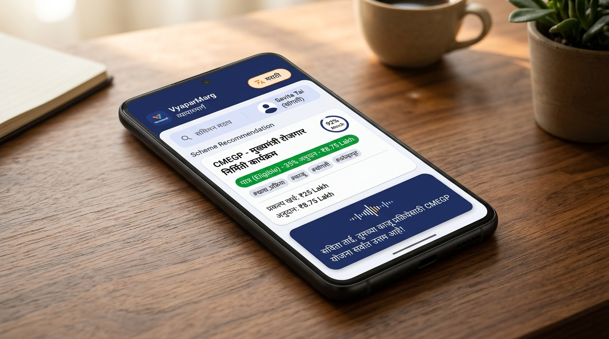 | 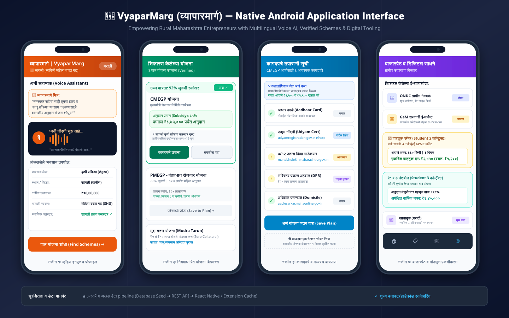 |
| *Savita Tai (Sangli) CMEGP 92% Match & 35% Subsidy Badge* | *Voice Input, Deterministic Schemes, Documents & Marketplaces* |

### 4. Browser Extension on Government Portals
| Desktop Chrome Showcase | Government In-Page Form Flow & Safety Boundary |
|:---:|:---:|
| 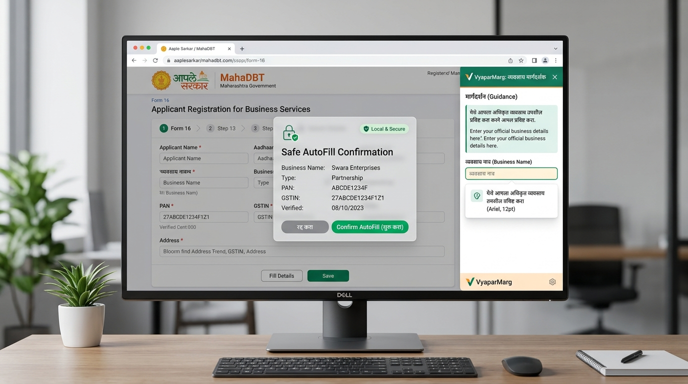 | 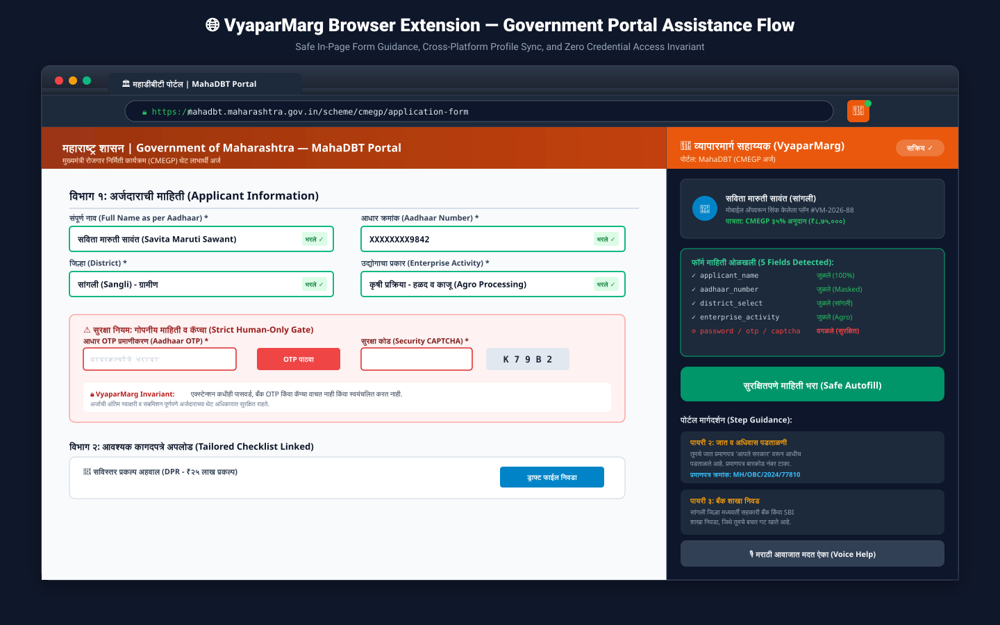 |
| *Standalone Manifest V3 extension active on MahaDBT* | *Safe autofill preview modal; strict exclusion of passwords, OTPs & CAPTCHAs* |

### 5. Detailed 3-Tier System Architecture
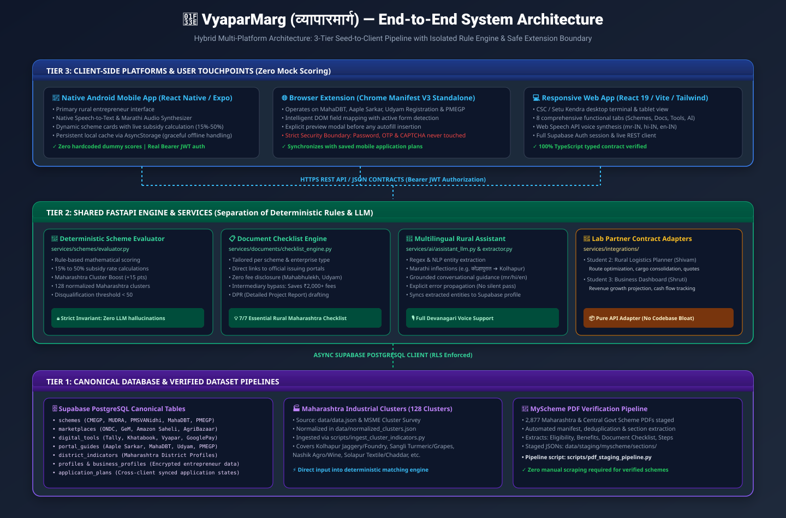
*Canonical Database Seeds (Tier 1) $\rightarrow$ Shared FastAPI Engine (Tier 2) $\rightarrow$ Native Mobile & Extension Caches (Tier 3).*

### 6. Live Production Deployed Web Application (Vercel & Render)

**Public Web URL:** [https://vyapar-marg.vercel.app/](https://vyapar-marg.vercel.app/) | **FastAPI Backend:** [https://vyaparmarg.onrender.com/](https://vyaparmarg.onrender.com/)

| 1. Authentication & 1-Click Demo Mode | 2. Multilingual AI Assistant (Marathi / Hindi / English) |
|:---:|:---:|
|  |  |
| *Guaranteed Supabase Auth + 1-Click Savita Tai Demo Access* | *Multilingual audio interface with Marathi & Hindi TTS* |

| 3. Deterministic Scheme Recommendations | 4. Marketplaces (ONDC & GeM) |
|:---:|:---:|
| 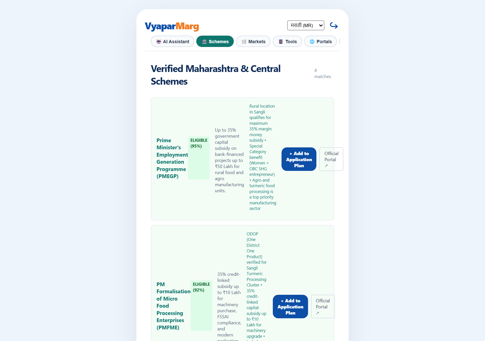 | 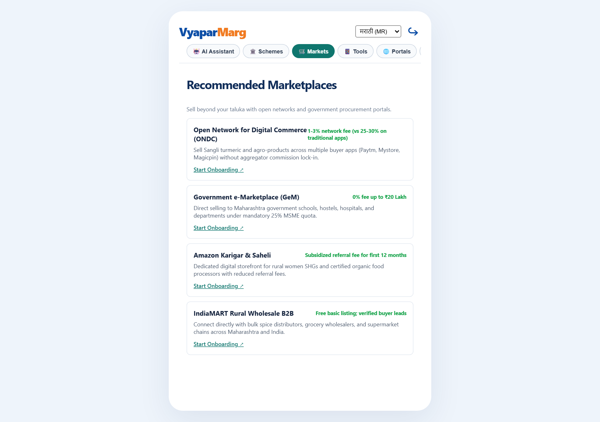 |
| *PMEGP 35% Capital Subsidy (95% Match) & PMFME ODOP* | *Low-fee open e-commerce protocol + Government MSME procurement* |

| 5. Digital MSME Tools Stack | 6. Rural Growth Dashboard |
|:---:|:---:|
| 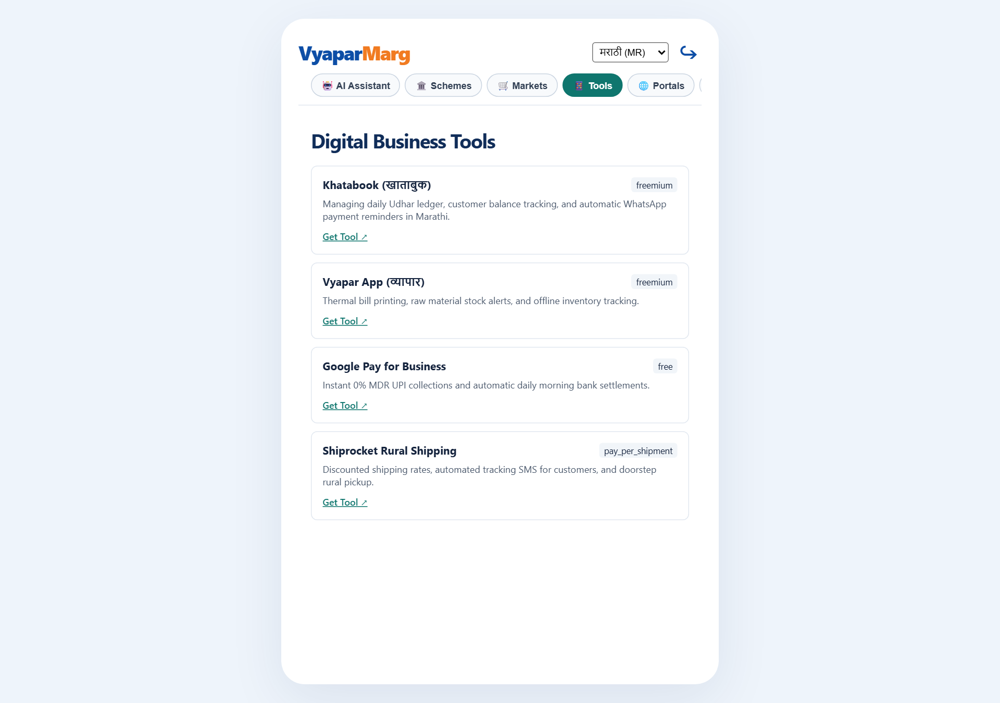 | 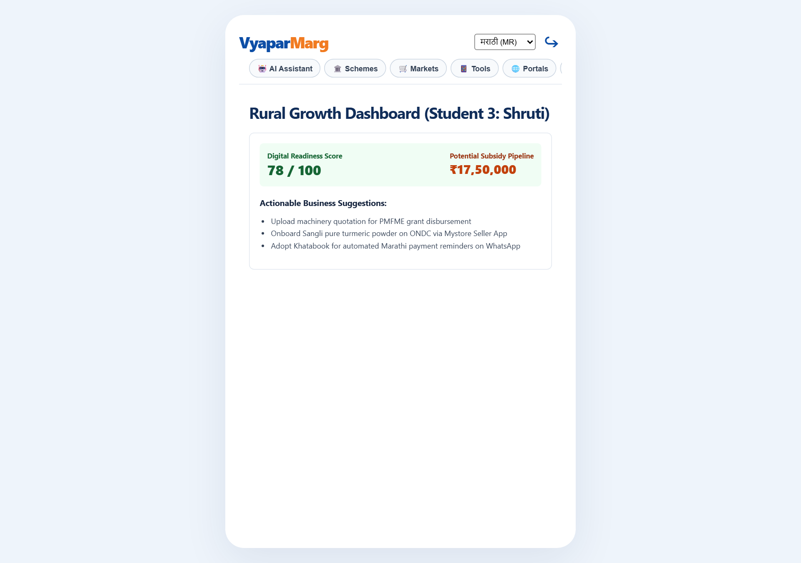 |
| *Khatabook Udhar ledger, Vyapar billing & Google Pay for Business* | *₹17.5 Lakh unlocked subsidies + 78/100 Digital Readiness Score* |

---

## 🏗️ Architecture & Component Breakdown

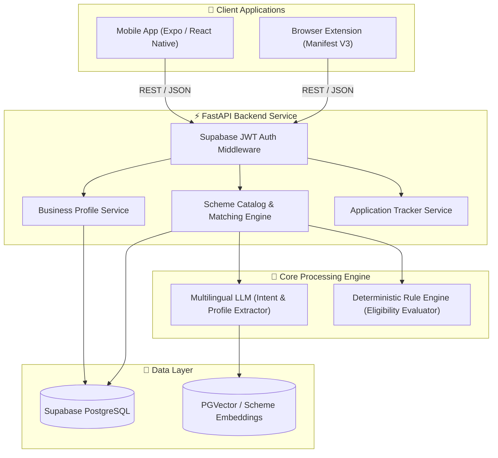

---

## 🛠️ Tech Stack & Technologies

* **Backend**: Python 3.11+, FastAPI, Pydantic v2, Uvicorn, Pytest
* **Database & Auth**: Supabase PostgreSQL, RLS Policies, Supabase Auth (JWT), Edge Functions
* **AI & NLP**: Multilingual LLM Integration, Custom Scheme Parser, Structured JSON Extraction
* **Frontend Apps**: React Native / Expo (Mobile), TypeScript (Extension & Monorepo)
* **Monorepo Tools**: `pnpm` workspace, Pytest, Python Virtual Environment (`.venv`)

---

## 📁 Repository Structure

```
VyaparMarg/
├── apps/
│   ├── mobile/             # React Native / Expo Mobile App
│   ├── mobile-native/      # Android / iOS Native modules
│   └── extension/          # Browser extension for CSC / Field Agents
├── services/
│   ├── ai/                 # LLM profile extraction & multilingual query module
│   ├── api/                # FastAPI Application Routes & Middleware
│   ├── documents/          # Document requirement checklist engine
│   └── schemes/            # Deterministic scheme eligibility scoring engine
├── packages/
│   ├── api-client/         # Shared API Client SDK
│   ├── config/             # Environment & configuration schemas
│   ├── schemas/            # Shared Pydantic / TypeScript data models
│   └── types/              # Monorepo type definitions
├── supabase/
│   ├── migrations/         # PostgreSQL schema migrations
│   ├── functions/          # Supabase Edge Functions
│   └── seed/               # Database seed data for schemes & test profiles
├── data/                   # Schemes master data & JSON benchmarks
├── docs/                   # Architecture specs, API contracts, and asset diagrams
└── README.md               # Main Project Documentation
```

---

## ⚡ Quick Start & Local Setup Guide

### 1. Prerequisites
* **Python**: `3.11+`
* **Node.js**: `v18+` & `pnpm`
* **Supabase CLI** (optional for local DB migrations)

### 2. Environment Setup
```bash
# Clone the repository
git clone https://github.com/rangeshsha-Rookie/VyaparMarg.git
cd VyaparMarg

# Activate Python Virtual Environment
.venv\Scripts\activate

# Install Node dependencies across monorepo
pnpm install
```

### 3. Run FastAPI Backend Server
```bash
uvicorn services.api.main:app --reload --port 8000
```
API Documentation will be available live at: `http://localhost:8000/docs`

### 4. Run Mobile Assistant (Expo)
```bash
cd apps/mobile
pnpm dev
```

### 5. Stage MyScheme PDFs

The PDF staging pipeline inventories source PDFs, hashes them with SHA-256,
deduplicates derived records, extracts page text, and extracts named sections.
It never deletes source PDFs and never updates public scheme records.

```bash
# Inspect the full run plan without writing files
py -3.12 .\scripts\pdf_staging_pipeline.py --dry-run

# Generate derived staging artifacts
py -3.12 .\scripts\pdf_staging_pipeline.py

# Use a custom source or staging directory
py -3.12 .\scripts\pdf_staging_pipeline.py C:\path\to\pdfs --output-dir C:\path\to\staging
```

Staging output is written to `data/staging/myscheme` and includes:

- `manifest.json`
- `pdf_inventory.json`
- `deduplication.json`
- `text_extraction.json`
- `text_extraction_failures.json`
- `text/<sha256>.txt`
- `sections/<sha256>.json`

### 6. Promote verified scheme staging records

Promotion is restricted to staging rows whose `verification_status` is `verified`.
The command runs in dry-run mode by default and never removes rejected rows.

```bash
# Inspect the promotion plan
py -3.12 .\scripts\promote_verified_schemes.py

# Apply inserts and safe updates
$env:SUPABASE_URL="https://project.supabase.co"
$env:SUPABASE_SERVICE_ROLE_KEY="server-secret"
py -3.12 .\scripts\promote_verified_schemes.py --apply --output data/staging/promotion-report.json

# Explicitly replace an existing verified public scheme
py -3.12 .\scripts\promote_verified_schemes.py --apply --force-update
```

Existing public schemes with `last_verified_at` are skipped unless
`--force-update` is supplied. `scheme_import_documents` and
`scheme_import_staging` remain the source provenance records.

---

## 🧪 Testing & Quality Assurance

Run the comprehensive unit & integration test suite:

```bash
pytest services/ -v
```

---

## 📄 License & Presentation Note

This project is developed and presented for **IDEA Lab Review**:
- **Author**: Rangesh Gupta (Roll No 53, SE CPMN A)
- **Guided by**: Prof. Archana Belge Ma'am
- **Institution**: Department of Computer Engineering / CPMN

---
<div align="center">
⭐ <i>Empowering India's Micro-Entrepreneurs with AI & Deterministic Scheme Discovery</i> ⭐
</div>
