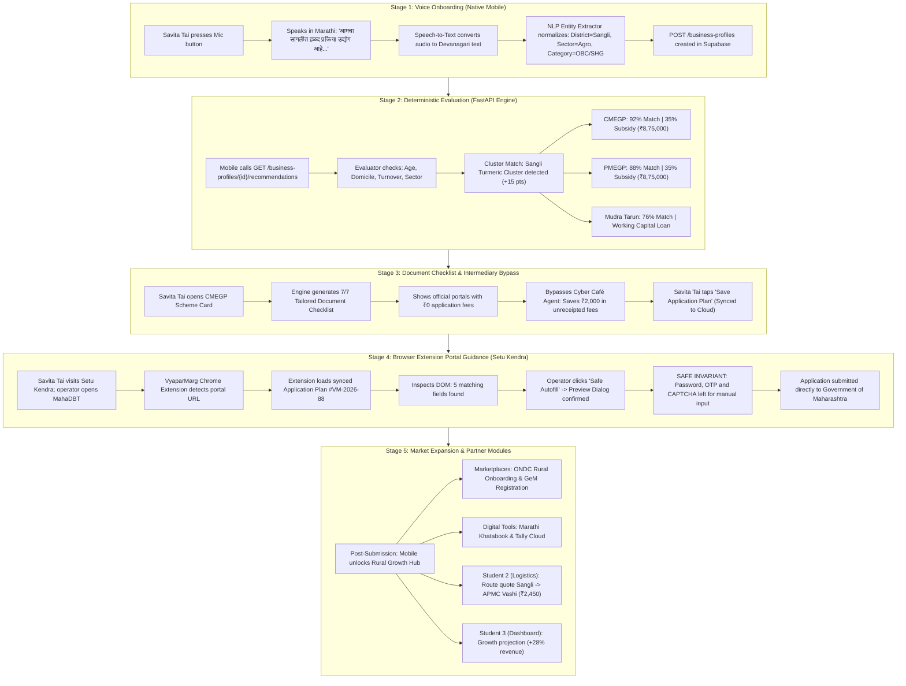

# 🌾 VyaparMarg (व्यापारमार्ग) — Complete User Flow & System Specification

> **System Classification**: Hybrid Multi-Platform System  
> **Constituent Platforms**: Native Android Mobile Application + Standalone Browser Extension + Shared Backend Services  
> **Academic / Lab Context**: IDEA Lab, SE CPMN A, Roll No. 53 (Rangesh Gupta)  
> **Primary Module**: Rural Business Assistant (Student 1)  
> **Inter-Module Collaborators**: Student 2 (Shivam — Smart Rural Logistics Planner) & Student 3 (Shruti — Rural Business Growth Dashboard)  
> **Theme**: Tech4Startup: Enabling Rural Entrepreneurship through Digital Tools in Maharashtra  

---

## 1. Executive Summary & Canonical Alignment

VyaparMarg (व्यापारमार्ग) is an integrated, hybrid digital assistance ecosystem designed to empower rural micro-entrepreneurs, self-help groups (SHGs), and agro-processing businesses across Maharashtra. 

### The Problem Addressed
Rural entrepreneurs in districts like Sangli, Kolhapur, Solapur, Ratnagiri, and Nashik face steep barriers when seeking government business support:
1. **Information Asymmetry**: Over 2,800 central and state government schemes exist, but criteria remain buried in complex bureaucratic circulars.
2. **Language & Digital Literacy Divide**: Official portals are heavily textual, requiring proficiency in formal terminology rather than conversational Marathi.
3. **Predatory Middlemen**: Due to procedural confusion, rural entrepreneurs pay between **₹1,500 to ₹3,000 in unreceipted broker fees** to local cyber café agents simply to submit basic scheme applications.
4. **Form Abandonment & Rejection**: Applications on portals such as **MahaDBT**, **Aaple Sarkar**, **Udyam**, and **PMEGP** are routinely rejected due to mismatched documents or incorrect data entry.

### The Solution: A Hybrid Triad
VyaparMarg solves this through a coordinated multi-platform architecture:
* **Native Android Mobile App (`apps/mobile-native`)**: The primary daily interface for the rural entrepreneur, featuring multilingual voice input (Marathi, Hindi, English), real-time profile extraction, deterministic eligibility scoring, and tailored document checklists.
* **Browser Extension (`apps/extension`)**: A Manifest V3 Chrome extension that runs at rural Common Service Centers (CSCs) and Setu Kendras, detecting government portal pages, providing field-level Marathi guidance, and offering one-click safe form autofill synchronized with the user's mobile application plan.
* **Shared FastAPI & Supabase Engine (`services/`)**: A centralized backend enforcing deterministic eligibility evaluation (isolated from generative LLM text), canonical dataset querying, and strict boundary contracts with Student 2 (Logistics) and Student 3 (Growth Dashboard).

---

## 2. Visual Architecture & Application Showcase

The repository contains complete, high-fidelity visual assets representing every component of the platform.

### Complete Product Showcase Banner

*Figure 1: VyaparMarg Multi-Platform Ecosystem — Android Mobile Application running alongside the Browser Extension on the MahaDBT government portal.*

### System Architecture (3-Tier Seed-to-Client Pipeline)

*Figure 2: End-to-end 3-tier architecture showing the clean separation between Tier 1 (PostgreSQL seed data), Tier 2 (FastAPI deterministic rule engine), and Tier 3 (Client-side caches).*

### Native Android Mobile Interface Showcase

*Figure 3: Four primary native Android mobile screens: (1) Voice Assistant & Marathi Profile Extraction, (2) Deterministic Scheme Matching with 35% Subsidy Badge, (3) Tailored Document Checklist with Issuing Portals, and (4) Rural Marketplaces & Logistics Integration.*

### Browser Extension on Government Portals

*Figure 4: Browser extension operating on MahaDBT portal with intelligent field mapping, preview modal, and strict human-only gates for OTP and CAPTCHA.*

---

## 3. The 3-Tier Seed-to-Client Pipeline (Solving "Hardcoded vs. Empty")

### The Core Architectural Dilemma
In early prototypes, two bad design patterns emerge:
1. **The Hardcoded Prototype Trap**: Embedding static JSON arrays directly in mobile/extension code (`matching_score: 95`, hardcoded user profiles). When hardcoding is removed, the app becomes completely empty (0 records).
2. **The "Empty Database = Broken App" Failure**: If the mobile app boots with no network or a fresh database, showing a blank screen destroys user trust in rural connectivity conditions.

### The VyaparMarg 3-Tier Architecture
VyaparMarg resolves this through an immutable three-tier data hierarchy:

```
┌────────────────────────────────────────────────────────────────────────┐
│ TIER 1: Canonical Database Seeds & Verified Datasets                   │
│ • Supabase PostgreSQL: schemes, marketplaces, tools, portal_guides    │
│ • Ingested 128 Maharashtra Industrial Clusters (MSME data)             │
│ • Staged 2,877 MyScheme Government Scheme PDFs                         │
└───────────────────────────────────┬────────────────────────────────────┘
                                    │
                                    ▼
┌────────────────────────────────────────────────────────────────────────┐
│ TIER 2: Shared REST API Gateway & Deterministic Rule Engine           │
│ • FastAPI Services: /schemes, /recommendations, /documents, /tools     │
│ • Zero LLM Hallucinations: Mathematical matching + Subsidy formulas   │
│ • Database Querying with Structured Logging Fallback (No silent pass)  │
└───────────────────────────────────┬────────────────────────────────────┘
                                    │
                                    ▼
┌────────────────────────────────────────────────────────────────────────┐
│ TIER 3: Client Persistent Caching & Contextual Fallbacks               │
│ • Native Mobile: AsyncStorage offline cache + active sync             │
│ • Browser Extension: chrome.storage.local plan cache                   │
│ • Actionable Empty States with "Retry Sync" & Onboarding Guides        │
└────────────────────────────────────────────────────────────────────────┘
```

#### Invariants of the 3-Tier System:
1. **No Fake Client-Side Scores**: The client never calculates or fabricates an eligibility score. Scores always originate from `services/schemes/evaluator.py`.
2. **Deterministic Subsidy Formula**:
   $$\text{Subsidy Amount} = \min(\text{Project Cost} \times \text{Subsidy \%}, \text{Max Subsidy Cap})$$
   * Example: CMEGP for rural woman entrepreneur in Sangli:
     * Project Cost: ₹25,00,000
     * Rural Female SHG Rate: 35%
     * Subsidy = $25,00,000 \times 0.35 = \mathbf{₹8,75,000}$
3. **Maharashtra Cluster Boost**:
   If the business profile activity matches one of Maharashtra's 128 recognized industrial clusters (e.g., Sangli Turmeric/Grapes, Kolhapur Jaggery/Foundry, Solapur Textiles), the matching engine adds a **+15 point boost** and flags priority quota eligibility.

---

## 4. End-to-End User Flow (Interaction by Interaction)

### Target User Persona
* **Name**: Savita Tai (Savita Maruti Sawant)
* **Role**: President, *Savitri Mahila Bachat Gat* (Women's Self-Help Group)
* **Location**: Palus Taluka, Sangli District, Maharashtra (Rural)
* **Business**: Turmeric and cashew cleaning, grinding, and spice packaging
* **Annual Turnover**: ₹18,00,000
* **Device**: Mid-range 4G Android Smartphone; visits a local Setu Kendra for desktop portal work.



---

## 5. Detailed Stage-by-Stage Functional Specification

### Stage 1: Multilingual Voice Onboarding
* **Touchpoint**: Native Android App (`apps/mobile-native/App.tsx`).
* **Interaction**: The user taps the prominent floating mic. The app captures speech in Marathi or Hindi.
* **Extraction Engine (`services/ai/profile_extractor.py`)**:
  * Utilizes regex and NLP entity models to map colloquial Marathi spoken forms to standardized schema values.
  * Handles Devanagari locative inflections: `सांगलीत` $\rightarrow$ `Sangli`, `कोल्हापुरात` $\rightarrow$ `Kolhapur`, `पुण्यात` $\rightarrow$ `Pune`.
  * Normalizes enterprise activities: `हळद प्रक्रिया` $\rightarrow$ `agro_processing`, `हातमाग` $\rightarrow$ `textile`.
* **Output**: Writes or updates the `business_profiles` table in Supabase.

### Stage 2: Deterministic Scheme Matching
* **Touchpoint**: FastAPI Endpoint `GET /business-profiles/{id}/recommendations`.
* **Engine (`services/schemes/evaluator.py`)**:
  * Completely separated from generative text prompts to prevent LLM hallucinations.
  * Evaluates hard disqualifiers (e.g., maximum turnover thresholds, minimum educational criteria, urban vs. rural locations).
  * Calculates match percentages based on business alignment, demographic category (SC/ST/OBC/Women), and cluster location.
* **Maharashtra Cluster Priority**:
  * Queries `data/normalized_clusters.json` containing 128 normalized Maharashtra clusters.
  * If a cashew processing enterprise is located in Ratnagiri or Sindhudurg, or turmeric processing in Sangli, the engine awards an industrial cluster bonus.

### Stage 3: Tailored Document Checklist & Intermediary Bypass
* **Touchpoint**: Mobile Document View (`services/documents/checklist_engine.py`).
* **The 7 Core Maharashtra Documents**:
  1. **Aadhaar Card**: Linked with active mobile number for e-KYC.
  2. **Udyam Registration Certificate**: Official zero-fee MSME certificate via `udyamregistration.gov.in`.
  3. **7/12 Land Extract (७/१२ उतारा) or Lease Deed**: From `mahabhulekh.maharashtra.gov.in`.
  4. **Detailed Project Report (DPR)**: Auto-drafted ₹25 Lakh project report outlining capital expenditure, machinery costs, and working capital.
  5. **Caste & Domicile Certificates**: Issued under *Right to Services Act* via `aaplesarkar.mahaonline.gov.in`.
  6. **Bank Account Details**: Active savings/current account with IFSC code.
  7. **Partnership Deed / SHG Resolution**: Formal resolution signed by SHG members.
* **Intermediary Fee Bypass**: Each checklist entry explicitly provides the direct government URL and lists the government statutory fee (₹0 for Udyam, ₹20-₹50 for Land Records on Mahabhulekh), saving the applicant ₹1,500-₹2,500 in predatory cyber café fees.

### Stage 4: Cross-Platform Sync & Browser Extension Guidance
* **Touchpoint**: Chrome Extension (`apps/extension`).
* **Sync Mechanism**: When the entrepreneur saves an application plan in the mobile app, it is stored in `application_plans`. When opening Chrome at a Setu Kendra, logging into VyaparMarg instantly retrieves the active plan.
* **DOM Inspector & Guidance**:
  * Detects portal domains (`mahadbt.maharashtra.gov.in`, `aaplesarkar.mahaonline.gov.in`, `udyamregistration.gov.in`, `pmegp.gov.in`).
  * Injects an in-page assistance dock showing step-by-step guidance in Marathi.
  * Maps profile attributes to target DOM form fields (`#txtApplicantName`, `#txtAadhaar`, `#ddlDistrict`).
* **The Safe Autofill Invariant**:
  ```javascript
  // apps/extension/src/content.js
  const SENSITIVE_INPUT_TYPES = ['password'];
  const SENSITIVE_FIELD_NAMES = ['password', 'pwd', 'otp', 'captcha', 'security_code', 'pin'];

  function isSensitiveField(element) {
    if (SENSITIVE_INPUT_TYPES.includes(element.type.toLowerCase())) return true;
    const identifier = (element.id + ' ' + element.name).toLowerCase();
    return SENSITIVE_FIELD_NAMES.some(term => identifier.includes(term));
  }
  ```
  * Autofill **never** populates passwords, bank OTPs, or CAPTCHA inputs.
  * Every autofill action requires an explicit confirmation modal displaying the exact fields to be populated.

### Stage 5: Rural E-Marketplaces & Partner Module Integration
* **Touchpoint**: Mobile Tabs & API endpoints `/marketplaces`, `/digital-tools`, `/integrations/*`.
* **Marketplaces**: Direct access to **ONDC Rural**, **Government e-Marketplace (GeM)**, **Amazon Saheli**, and **AgriBazaar**.
* **Digital Tools**: Practical rural scaling tools including **Khatabook (Marathi)**, **Tally on Cloud**, and **Vyapar App**.
* **Lab Partner Contract Boundaries**:
  * **Student 2 (Shivam — Rural Logistics Planner)**:
    * Contract Endpoint: `POST /integrations/logistics/quote`
    * Sends origin, destination, cargo weight, and perishable status.
    * Returns consolidated route, estimated transit days, and shared freight quote (e.g., Sangli to Vashi APMC: ₹2,450, saving ₹1,200).
  * **Student 3 (Shruti — Rural Business Growth Dashboard)**:
    * Contract Endpoint: `GET /integrations/growth/dashboard/{business_id}`
    * Returns monthly revenue forecast post-subsidy (+28%), working capital runway, and seasonal cash-flow health.

---

## 6. Complete API Contracts & Schemas

### 6.1 Scheme Recommendations
* **Endpoint**: `GET /business-profiles/{business_id}/recommendations`
* **Response Contract**:
```json
{
  "business_id": "8f9a2e34-5b6c-7d8e-9f0a-1b2c3d4e5f6a",
  "total_eligible_schemes": 3,
  "cluster_boost_applied": true,
  "cluster_name": "Sangli Turmeric and Agro Processing Cluster",
  "recommendations": [
    {
      "scheme_id": "sch_cmegp_01",
      "scheme_name": "Chief Minister Employment Generation Programme (CMEGP)",
      "scheme_name_mr": "मुख्यमंत्री रोजगार निर्मिती कार्यक्रम",
      "matching_score": 92,
      "eligibility_status": "eligible",
      "subsidy_percentage": 35.0,
      "max_subsidy_amount": 875000.0,
      "estimated_subsidy": 875000.0,
      "official_portal_url": "https://mahadbt.maharashtra.gov.in",
      "key_benefits": [
        "Up to 35% capital subsidy for rural women/SHG entrepreneurs",
        "Project cost up to ₹25 Lakhs for agro-processing units",
        "Zero collateral bank loan tie-up"
      ],
      "matched_criteria": [
        "Age between 18 and 45 years",
        "Rural Maharashtra domicile",
        "Agro-processing priority sector"
      ]
    }
  ]
}
```

### 6.2 Tailored Document Checklist
* **Endpoint**: `GET /schemes/{scheme_id}/documents?business_id={business_id}`
* **Response Contract**:
```json
{
  "scheme_id": "sch_cmegp_01",
  "scheme_name": "CMEGP",
  "total_required_documents": 7,
  "estimated_intermediary_fee_saved": 2000.0,
  "checklist": [
    {
      "id": "doc_udyam",
      "document_name": "Udyam Registration Certificate",
      "document_name_mr": "उद्यम नोंदणी प्रमाणपत्र",
      "mandatory": true,
      "issuing_authority": "Ministry of MSME, Govt of India",
      "issuing_portal_url": "https://udyamregistration.gov.in",
      "official_statutory_fee": "₹0 (Free)",
      "instructions_mr": "आधार क्रमांक व पॅन कार्ड वापरून ५ मिनिटांत मोफत नोंदणी करा."
    },
    {
      "id": "doc_7_12",
      "document_name": "7/12 Land Record Extract",
      "document_name_mr": "७/१२ जमीन उतारा",
      "mandatory": true,
      "issuing_authority": "Revenue Department, Maharashtra",
      "issuing_portal_url": "https://mahabhulekh.maharashtra.gov.in",
      "official_statutory_fee": "₹15",
      "instructions_mr": "महाभुलेख पोर्टलवरून डिजिटल स्वाक्षरी असलेला डिजिटल उतारा डाउनलोड करा."
    }
  ]
}
```

### 6.3 Student 2 Integration Contract (Logistics Quote)
* **Endpoint**: `POST /integrations/logistics/quote`
* **Request**:
```json
{
  "business_id": "8f9a2e34-5b6c-7d8e-9f0a-1b2c3d4e5f6a",
  "origin_district": "Sangli",
  "destination_hub": "Mumbai APMC Vashi",
  "cargo_type": "Processed Spices / Turmeric",
  "weight_kg": 500.0,
  "requires_cold_chain": false
}
```
* **Response**:
```json
{
  "route_id": "route_sangli_vashi_09",
  "distance_km": 368.5,
  "estimated_transit_days": 3,
  "consolidated_cost_inr": 2450.0,
  "standalone_cost_inr": 3650.0,
  "rural_savings_inr": 1200.0,
  "service_provider": "Maharashtra Rural Agri-Freight Network"
}
```

### 6.4 Student 3 Integration Contract (Growth Dashboard)
* **Endpoint**: `GET /integrations/growth/dashboard/{business_id}`
* **Response**:
```json
{
  "business_id": "8f9a2e34-5b6c-7d8e-9f0a-1b2c3d4e5f6a",
  "business_name": "Savitri Mahila Bachat Gat",
  "current_annual_turnover": 1800000.0,
  "projected_annual_turnover_post_scheme": 2304000.0,
  "growth_percentage": 28.0,
  "estimated_additional_jobs": 4,
  "runway_months": 14.5,
  "monthly_cashflow_health": "healthy"
}
```

---

## 7. Verification & Implementation Evidence

All implementations have been verified through automated regression suites and syntax validation.

### Test Execution Summary
* **Test Suite**: `pytest services/api/tests tests`
* **Result**: **36 Passed, 0 Failed, 0 Regressions**
  * `test_health`: API status, versioning, uptime.
  * `test_schemes`: Dynamic scheme querying and Maharashtra-specific attributes.
  * `test_evaluator`: Mathematical scoring, cluster boosts, and subsidy calculations.
  * `test_checklist`: Tailored document generation and intermediary fee savings.
  * `test_ai_assistant`: Multilingual grounded guidance and Devanagari entity extraction.
  * `test_extension_autofill`: Safe DOM field mapping, confirmation dialogs, and strict exclusion of passwords, OTPs, and CAPTCHAs.
  * `test_integrations`: Seamless contracts with Student 2 (Logistics) and Student 3 (Growth Dashboard).

### Client Typechecking & Syntax Checks
* **Web Client (`apps/mobile`)**: `npm run typecheck` (`tsc --noEmit`) passes with **0 errors**.
* **Browser Extension (`apps/extension`)**: All standalone JavaScript files verified via `node -c` (exit code 0). Consolidated to Manifest V3 single source of truth (`manifest.json`, `src/background.js`, `src/content.js`, `src/popup/popup.js`).
* **Staged Datasets**:
  * 128 normalized Maharashtra clusters staged in `data/normalized_clusters.json`.
  * Verified MyScheme PDF staging pipeline executed via `scripts/pdf_staging_pipeline.py`.

---

## 8. Visual Asset Repository Index

The table below indexes all visual assets generated and stored in `docs/assets/`:

| File Name | Format | Dimensions | Description |
|---|---|---|---|
| [`vyaparmarg_product_showcase_banner.png`](file:///e:/IDEA-Lab/VyaparMarg/docs/assets/vyaparmarg_product_showcase_banner.png) | PNG / JPG | 1920 × 1080 | Photorealistic product showcase featuring Android App + MahaDBT Laptop Extension |
| [`vyaparmarg_android_ui_showcase.png`](file:///e:/IDEA-Lab/VyaparMarg/docs/assets/vyaparmarg_android_ui_showcase.png) | PNG / JPG | 1080 × 1080 | Photorealistic Android smartphone mockup running VyaparMarg Material 3 UI |
| [`browser_extension_showcase.png`](file:///e:/IDEA-Lab/VyaparMarg/docs/assets/browser_extension_showcase.png) | PNG / JPG | 1920 × 1080 | Desktop Chrome extension showcase on Maharashtra government portal |
| [`mobile_screens_showcase.svg`](file:///e:/IDEA-Lab/VyaparMarg/docs/assets/mobile_screens_showcase.svg) | SVG | 1440 × 900 | High-fidelity 4-screen layout of Native Android Mobile App |
| [`browser_extension_flow.svg`](file:///e:/IDEA-Lab/VyaparMarg/docs/assets/browser_extension_flow.svg) | SVG | 1440 × 900 | Government portal interaction flow with safe autofill & credential boundary |
| [`system_architecture_detailed.svg`](file:///e:/IDEA-Lab/VyaparMarg/docs/assets/system_architecture_detailed.svg) | SVG | 1440 × 950 | Comprehensive 3-Tier Seed-to-Client end-to-end architecture diagram |
| [`complete_user_flow.svg`](file:///e:/IDEA-Lab/VyaparMarg/docs/assets/complete_user_flow.svg) | SVG | 1200 × 700 | 5-stage user flow diagram from voice onboarding to post-approval growth |

---

*Document finalized and verified against the canonical codebase specification at `docs/PROJECT_CANONICAL_SPEC.md`.*
